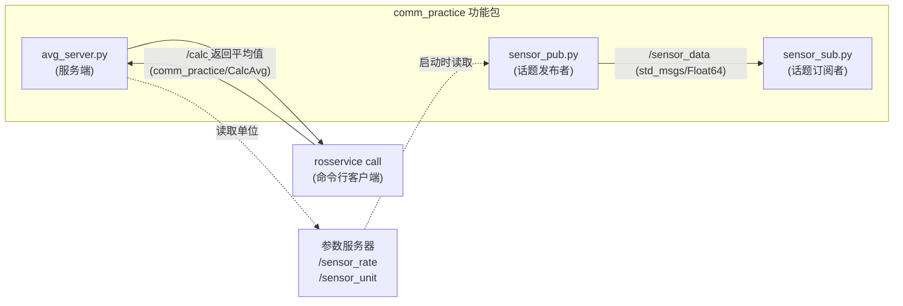

# 2.5 通信机制实操

> 本节学习目标：把话题、服务、参数三种通信机制放进同一个可运行的系统，亲手实现并验证；同时练习"只用命令行就能判断系统是否正常"的能力。

---

## 2.5.1 本节要做什么

前面三节是**分机制学习**：2.1 讲话题，2.2 讲服务，2.3 讲参数，每个机制都从零建了一个功能包。学完之后你掌握了三种工具，但它们还是三座孤岛。

真实机器人系统里，这三种机制是**同时存在**的。一个典型的移动机器人同时跑着：

- 激光雷达驱动通过**话题**持续发布 `/scan`
- 导航模块通过**服务**请求"从 A 到 B 规划一条路径"
- 参数服务器里存着 `/max_vel_x`、`/robot_radius` 这些配置

本节就照这个结构搭一个小系统。三个节点，三种机制，都在一个包 `comm_practice` 里：



三个任务的设计意图：

| 任务 | 练什么 | 关键差异点 |
|------|--------|-----------|
| 任务一：话题收发 | 参照 2.1 节的模式独立实现 | 参数化发布频率，验证参数改动对话题频率的影响 |
| 任务二：服务实现 | 参照 2.2 节的模式独立实现 | Python 自定义 srv，命令行客户端调用 |
| 任务三：参数操作 | 运行时改参数并观察行为变化 | 体会参数"需要节点主动读取"的特点 |

> 💡 **建议做法**：先不要看代码，照着每节的"要求"自己写一遍。写不出来再对照代码。三种机制的代码模板你已经在前三节见过，这里的价值在于**独立完成 + 用命令行验证**。

---

## 2.5.2 准备工作：创建功能包

```bash
cd ~/ros_demo/src
catkin_create_pkg comm_practice roscpp rospy std_msgs message_generation
mkdir -p comm_practice/srv
cd ~/ros_demo
```

因为要定义自定义服务，`package.xml` 里需要补上运行时依赖 `message_runtime`（这一项 `catkin_create_pkg` 不会自动加）：

```xml
<!-- comm_practice/package.xml -->
<build_export_depend>message_generation</build_export_depend>
<exec_depend>message_runtime</exec_depend>
```

`CMakeLists.txt` 里加上服务文件声明：

```cmake
# comm_practice/CMakeLists.txt
find_package(catkin REQUIRED COMPONENTS
  roscpp
  rospy
  std_msgs
  message_generation
)

add_service_files(
  FILES
  CalcAvg.srv
)

generate_messages(
  DEPENDENCIES
  std_msgs
)

catkin_package(
  CATKIN_DEPENDS roscpp rospy std_msgs message_runtime
)
```

`CalcAvg.srv` 的定义：客户端送进来一串浮点数，服务端返回平均值和样本个数。

```text
# comm_practice/srv/CalcAvg.srv
float64[] numbers
---
float64 average
int32 count
```

字段设计上有个细节值得注意：**响应用 `int32 count` 而不是把个数塞进 `average`**。服务调用不成功时返回 `0.0` 是无法和"平均值恰好是 0"区分的，多带一个计数字段，客户端就能判断数据是否有效。这类冗余字段在真实接口设计里很常见。

先编译一次，确认消息和服务文件能被正确生成：

```bash
cd ~/ros_demo
catkin_make
source devel/setup.bash

# 验证服务类型已生成
rossrv show comm_practice/CalcAvg
# float64[] numbers
# ---
# float64 average
# int32 count
```

`rossrv show` 能输出内容，说明 `.srv` 已经通过 `message_generation` 编译进了 Python 和 C++ 模块。**后面的代码写不出来时，先用这条命令确认环境没问题**，能快速排除"是环境坏了还是代码写错了"。

---

## 2.5.3 任务一：话题发布与订阅

### 要求

写一个发布者 `sensor_pub.py` 和一个订阅者 `sensor_sub.py`，满足：

1. 发布者向 `/sensor_data` 发布 `std_msgs/Float64`，数值是模拟的传感器读数
2. 发布频率**不写死**，从私有参数 `~rate` 读取，默认 10 Hz
3. 订阅者收到消息后打印，并额外打印一个累计收到的消息条数
4. 发布者每发一条，日志格式为 `发布第 N 次: 数值 = x.xx`

### 发布者实现

```python
#!/usr/bin/env python
# -*- coding: utf-8 -*-

import math
import rospy
from std_msgs.msg import Float64


def sensor_publisher():
    rospy.init_node("sensor_pub")

    # 频率从私有参数读取：~rate 实际存储为 /sensor_pub/rate
    # 读取失败（参数不存在）时返回默认值 10.0
    rate_hz = rospy.get_param("~rate", 10.0)

    # 单位参数在话题数据里用不上，这里只做启动打印，见任务三
    unit = rospy.get_param("/sensor_unit", "raw")

    pub = rospy.Publisher("/sensor_data", Float64, queue_size=10)
    rate = rospy.Rate(rate_hz)

    rospy.loginfo("sensor_pub 启动，发布频率 %.2f Hz，单位 %s", rate_hz, unit)

    count = 0
    while not rospy.is_shutdown():
        msg = Float64()
        # 用一个正弦波模拟传感器读数，让曲线有变化，便于 rqt_plot 观察
        msg.data = 5.0 * math.sin(count * 0.1) + 5.0

        pub.publish(msg)
        count += 1
        rospy.loginfo("发布第 %d 次: 数值 = %.2f", count, msg.data)

        rate.sleep()


if __name__ == "__main__":
    try:
        sensor_publisher()
    except rospy.ROSInterruptException:
        pass
```

### 订阅者实现

```python
#!/usr/bin/env python
# -*- coding: utf-8 -*-

import rospy
from std_msgs.msg import Float64

recv_count = 0


def data_callback(msg):
    global recv_count
    recv_count += 1
    rospy.loginfo("收到第 %d 条数据: %.2f", recv_count, msg.data)


def sensor_subscriber():
    rospy.init_node("sensor_sub")

    rospy.Subscriber("/sensor_data", Float64, data_callback, queue_size=10)

    rospy.loginfo("sensor_sub 已订阅 /sensor_data，等待数据...")
    rospy.spin()


if __name__ == "__main__":
    try:
        sensor_subscriber()
    except rospy.ROSInterruptException:
        pass
```

加执行权限：

```bash
chmod +x ~/ros_demo/src/comm_practice/scripts/sensor_pub.py
chmod +x ~/ros_demo/src/comm_practice/scripts/sensor_sub.py
```

### 运行与验证

```bash
# 终端 1
roscore

# 终端 2
cd ~/ros_demo && source devel/setup.bash
rosrun comm_practice sensor_pub.py

# 终端 3
cd ~/ros_demo && source devel/setup.bash
rosrun comm_practice sensor_sub.py
```

应该看到发布者和订阅者交替打印。然后**不要关掉任何东西**，在终端 4 用 2.4 节的命令检查系统：

```bash
rosnode list
# /rosout
# /sensor_pub
# /sensor_sub

rostopic info /sensor_data
# Type: std_msgs/Float64
# Publishers:
#  * /sensor_pub (http://localhost:xxxxx/)
# Subscribers:
#  * /sensor_sub (http://localhost:xxxxx/)

rostopic hz /sensor_data
# average rate: 9.998
```

`rostopic hz` 显示约 10 Hz，与前两节里看到的 9.5 Hz 不同。原因有两个：一是这里没有 `rospy.loginfo` 之外的重负载，二是 `rostopic hz` 的统计窗口是滑动平均值，短时间观察会偏向 10.0。**这类"频率对不上"的疑问，永远先用 `rostopic hz` 实测，不要靠猜**。

### 手动测试：验证参数对频率的影响

现在做一件在 2.1 节做不到的事：**在发布者已经运行的情况下，验证参数是否真的被读取了**。

先改参数再重启节点（因为这里的代码只在启动时读一次）：

```bash
# 关掉发布者（终端 2 按 Ctrl+C）

rosparam set /sensor_pub/rate 2.0

# 重新启动
rosrun comm_practice sensor_pub.py
# [INFO] sensor_pub 启动，发布频率 2.00 Hz，单位 raw

# 终端 4 验证
rostopic hz /sensor_data
# average rate: 2.000
```

这里出现了一个**必须记住的行为**：如果你在发布者运行时直接 `rosparam set /sensor_pub/rate 2.0`，频率**不会变**。因为代码里 `rospy.get_param` 只在启动时执行了一次，参数服务器不会主动通知节点参数变了。

想验证这一点，就在节点运行时改参数，然后看 `rostopic hz`：它会稳定待在 10 Hz。这个实验是理解[2.6 节](11-communication-comparison.md)选型讨论的关键素材。

> ⚠️ **私有参数 `~rate` 的名字**。代码里写的是 `~rate`，但它在 Master 上实际存储为 `/sensor_pub/rate`，前缀是**节点名**而不是包名。所以 `rosparam set` 时要用 `/sensor_pub/rate`。用 `rosparam list | grep rate` 可以确认实际名字。

---

## 2.5.4 任务二：服务端与客户端

### 要求

写一个服务端 `avg_server.py`，满足：

1. 提供 `comm_practice/CalcAvg` 服务，服务名 `/calc_avg`
2. 收到请求后计算 `numbers` 的平均值，返回 `average` 和 `count`
3. 请求为空列表时返回 `average = 0.0`、`count = 0`，**不能崩**
4. 用 `rosservice call` 命令行调用成功，再写一个 Python 客户端调用

空列表的处理是服务端健壮性的基本要求。`sum([]) / len([])` 会抛 `ZeroDivisionError`，而服务端回调里抛出未捕获异常，结果是**服务调用方收到一个含糊的错误，服务端自己打印一堆堆栈**。服务端必须把这类边界情况处理在自己的回调里。

### 服务端实现

```python
#!/usr/bin/env python
# -*- coding: utf-8 -*-

import rospy
from comm_practice.srv import CalcAvg, CalcAvgResponse


def handle_calc_avg(req):
    # 边界情况：空列表直接返回 0，不能让 ZeroDivisionError 冒出去
    if len(req.numbers) == 0:
        rospy.logwarn("收到空列表请求，返回平均值 0.0")
        return CalcAvgResponse(average=0.0, count=0)

    avg = sum(req.numbers) / len(req.numbers)
    rospy.loginfo("收到 %d 个样本，平均值 %.4f", len(req.numbers), avg)

    return CalcAvgResponse(average=avg, count=len(req.numbers))


def avg_server():
    rospy.init_node("avg_server")

    # 单位只用于打印，服务本身不关心单位
    unit = rospy.get_param("/sensor_unit", "raw")

    rospy.Service("/calc_avg", CalcAvg, handle_calc_avg)
    rospy.loginfo("avg_server 已就绪，等待 /calc_avg 请求（数据单位: %s）", unit)

    rospy.spin()


if __name__ == "__main__":
    try:
        avg_server()
    except rospy.ROSInterruptException:
        pass
```

### 用命令行调用：不需要写客户端

这是服务通信相对话题通信的一大便利。**命令行就能完整测试服务端**，代码写完立刻可以验证：

```bash
# 终端 1
roscore

# 终端 2
cd ~/ros_demo && source devel/setup.bash
rosrun comm_practice avg_server.py

# 终端 3
source ~/ros_demo/devel/setup.bash

# 先确认服务在线
rosservice list | grep calc_avg
# /calc_avg

rosservice info /calc_avg
# Node: /avg_server
# Type: comm_practice/CalcAvg

# 正常调用
rosservice call /calc_avg "{numbers: [1.0, 2.0, 3.0, 4.0]}"
# average: 2.5
# count: 4

# 空列表，验证边界处理
rosservice call /calc_avg "{numbers: []}"
# average: 0.0
# count: 0
```

请注意一个现象：调用 `rosservice call` 时，**命令行会一直等到服务端返回才打印结果**。这就是服务通信的"同步"语义，也是它和 `rostopic pub` 最直观的差别。

### Python 客户端实现

```python
#!/usr/bin/env python
# -*- coding: utf-8 -*-

import sys
import rospy
from comm_practice.srv import CalcAvg, CalcAvgRequest


def avg_client(numbers):
    rospy.init_node("avg_client")

    # 关键一步：先等服务上线，最多等 5 秒
    # 不等待的话，服务端还没启动就会直接抛 ServiceException
    rospy.loginfo("等待服务 /calc_avg ...")
    try:
        rospy.wait_for_service("/calc_avg", timeout=5.0)
    except rospy.ROSException:
        rospy.logerr("等待 /calc_avg 超时，请确认 avg_server 已启动")
        return

    try:
        # 创建服务代理对象，之后调用它就像调用普通函数
        calc_avg = rospy.ServiceProxy("/calc_avg", CalcAvg)
        req = CalcAvgRequest(numbers=numbers)
        resp = calc_avg(req)

        rospy.loginfo("发送 %d 个样本 -> 平均值 %.4f (服务端计数 %d)",
                      len(numbers), resp.average, resp.count)
    except rospy.ServiceException as e:
        rospy.logerr("服务调用失败: %s", e)


if __name__ == "__main__":
    # 允许从命令行传入样本：rosrun comm_practice avg_client.py 1 2 3
    samples = [float(x) for x in sys.argv[1:]] if len(sys.argv) > 1 else [10.0, 20.0, 30.0]
    avg_client(samples)
```

```bash
chmod +x ~/ros_demo/src/comm_practice/scripts/avg_client.py

rosrun comm_practice avg_client.py
# [INFO] 等待服务 /calc_avg ...
# [INFO] 发送 3 个样本 -> 平均值 20.0000 (服务端计数 3)

rosrun comm_practice avg_client.py 1 2 3 4 5
# [INFO] 发送 5 个样本 -> 平均值 3.0000 (服务端计数 5)
```

### 三个容易踩的坑

**第一，`rospy.wait_for_service` 的 timeout 参数容易被漏掉**。不写 timeout 时它无限等待，节点会静默挂起。排查"客户端没反应"时，先怀疑这里。

**第二，`ServiceProxy` 应该在 `wait_for_service` 之后创建**。顺序反了不会报错，但连接过程可能拿到过早的句柄。

**第三，服务的请求和响应类是自动生成的**，命名规则是 `服务名Request` 和 `服务名Response`。导入时如果写错：

```python
# 正确
from comm_practice.srv import CalcAvg, CalcAvgRequest, CalcAvgResponse

# 报 ImportError
from comm_practice.srv import CalcAvgSrv
```

导入失败几乎总是三种原因：`.srv` 没编译、没 `source devel/setup.bash`、包依赖没写全（`message_runtime` 漏了）。

---

## 2.5.5 任务三：参数操作

### 要求

只用命令行完成下面这套操作，并观察每一步对其他节点的影响：

1. 设置 `/sensor_unit` 为 `"celsius"`，重启发布者，看启动日志的单位是否变化
2. 用 `rosparam dump` 导出一份参数快照
3. 清空参数，再用 `rosparam load` 恢复
4. 用 `rosparam get /` 看看系统里到底有多少参数

### 执行过程

```bash
# 1. 设置单位参数
rosparam set /sensor_unit "celsius"

# 重启发布者和服务端，观察启动日志
rosrun comm_practice sensor_pub.py
# [INFO] sensor_pub 启动，发布频率 10.00 Hz，单位 celsius

rosrun comm_practice avg_server.py
# [INFO] avg_server 已就绪，等待 /calc_avg 请求（数据单位: celsius）
```

两个节点读的是**同一个参数** `/sensor_unit`，都拿到了 `celsius`。这就是参数服务器"全局共享"的含义：一份配置，所有节点可见。

```bash
# 2. 导出参数快照
cd ~/ros_demo
rosparam dump practice_params.yaml
cat practice_params.yaml
```

输出大致如下：

```yaml
rosdistro: 'noetic'
roslaunch:
  uris:
    host_localhost__11311: http://localhost:11311/
rosversion: '1.16.0'
run_id: 3a1f9c2e-...
sensor_unit: celsius
sensor_pub:
  rate: 2.0
```

注意 `sensor_pub: rate: 2.0` 这一段，就是任务一里从 `~rate` 读的那个私有参数在 YAML 里的样子。**私有参数在导出文件里表现为一个嵌套字典**，重新 `load` 时会还原成 `/sensor_pub/rate`。

```bash
# 3. 清空后恢复
rosparam delete /sensor_unit
rosparam get /sensor_unit 2>/dev/null || echo "已删除"

rosparam load practice_params.yaml
rosparam get /sensor_unit
# celsius
```

> ⚠️ **`rosparam load` 是覆盖式的追加，不是替换**。它把文件里的键写进参数服务器，但不会删除文件里没有的键。想把系统恢复到"只有文件里那些参数"的状态，得先逐个删除或者重启 `roscore`。

```bash
# 4. 看看系统里有多少参数
rosparam list | wc -l
rosparam list | grep -v rosout | grep -v roslaunch | grep -v rosversion
```

`/rosdistro`、`/rosversion`、`/run_id`、`/roslaunch/uris/*` 这些都是 `roscore` 和 `roslaunch` 自己写的，不属于你的业务参数。**用 `grep -v` 过滤掉系统参数**是查自己参数时的常规操作。

### 参数与话题的联动验证

把三个节点同时跑起来，用 2.4 节的工具做一次完整检查：

```bash
# 终端 4
rosnode list
# /avg_server
# /rosout
# /sensor_pub
# /sensor_sub

rostopic hz /sensor_data          # 应显示约 10 Hz 或 2 Hz，取决于 /sensor_pub/rate
rosservice call /calc_avg "{numbers: [1.5, 2.5, 3.5]}"
rosparam get /sensor_unit
```

三种机制在一个系统里同时工作，而我们只用了命令行就确认了每一环的状态。**这正是 2.4 节那套流程的实用价值**。

---

## 2.5.6 完整验证清单

把这份清单当成提交代码前的自检。每一项都可以用命令行完成，不依赖任何图形工具。

| 检查项 | 命令 | 期望结果 |
|--------|------|---------|
| 三个节点都在跑 | `rosnode list` | 出现 `sensor_pub`、`sensor_sub`、`avg_server` |
| 话题已建立连接 | `rostopic info /sensor_data` | Publishers 和 Subscribers 都不为空 |
| 话题频率符合参数 | `rostopic hz /sensor_data` | 与 `/sensor_pub/rate` 一致 |
| 话题数据可读 | `timeout 3 rostopic echo -n 1 /sensor_data` | 打印出一个 `data:` 数值 |
| 消息类型正确 | `rostopic type /sensor_data` | `std_msgs/Float64` |
| 服务已注册 | `rosservice list \| grep calc_avg` | 输出 `/calc_avg` |
| 服务定义正确 | `rossrv show comm_practice/CalcAvg` | 请求 `float64[]`，响应 `average` + `count` |
| 服务可调用 | `rosservice call /calc_avg "{numbers: [1.0, 2.0]}"` | `average: 1.5`，`count: 2` |
| 服务边界安全 | `rosservice call /calc_avg "{numbers: []}"` | `average: 0.0`，`count: 0`，服务端不崩 |
| 参数可读 | `rosparam get /sensor_unit` | 返回设置的值 |
| 参数可持久化 | `rosparam dump p.yaml && rosparam load p.yaml` | 参数内容不变 |

### 现象与原因对照

| 现象 | 最可能的原因 |
|------|-------------|
| `rosrun` 报 `[rosrun] Couldn't find executable` | 脚本没加执行权限，或没 `source devel/setup.bash` |
| `ImportError: No module named comm_practice.srv` | `.srv` 没编译，或编译后没重新 `source` |
| `rostopic echo` 无输出但节点都在 | 发布者的 `while` 循环里没调用 `publish()` |
| 订阅者一条也收不到 | 话题名不一致（一边 `/sensor_data`，一边 `sensor_data`） |
| `rosservice call` 报服务不存在 | 服务端没启动，或服务名写错 |
| 服务端打印 `ZeroDivisionError` | 空列表没做边界判断 |
| 改了 `rosparam` 但节点行为没变 | 节点只在启动时读参数，需要重启或用动态参数 |
| 客户端一直挂着不返回 | `wait_for_service` 没设 timeout，且服务端未启动 |

> ⚠️ **话题名大小写和斜杠是常见错误源**。`/sensor_data` 和 `sensor_data` 在默认全局命名空间下等价，但一旦节点被放进命名空间（第 4 章的内容），两者就会指向不同的话题。**统一写绝对路径（带 `/`）能避免大部分歧义**。

---

## 本节小结

| 概念 | 说明 |
|------|------|
| **三机制并存** | 话题传数据流、服务做请求响应、参数存配置，真实系统里同时存在 |
| **参数化频率** | `rospy.get_param("~rate", 默认值)` 让频率可配置，不用改代码 |
| **服务边界处理** | 服务端回调必须自行处理空输入等异常，否则调用方收到模糊错误 |
| **服务同步语义** | `rosservice call` 阻塞到返回，这是与 `rostopic pub` 最直观的差别 |
| **`wait_for_service`** | 客户端调用前先等服务上线，记得设 timeout |
| **参数读取时机** | 参数只在节点主动读取时生效，改动不会自动通知节点 |
| **`rosparam dump/load`** | 保存和恢复一套调参结果，注意 `load` 不删除文件外的键 |
| **命令行即验证手段** | 不写测试代码就能确认每个通信环节是否正常 |

🔧 **动手练习**：给 `sensor_pub.py` 加上"运行时响应参数变化"的能力。提示：在 `while` 循环里周期性重新 `rospy.get_param("~rate")`，发现变化就重建 `rospy.Rate` 对象，然后用 `rosparam set` 验证频率是否实时改变。做完这个练习，你就能理解为什么第 10 章的动态参数（dynamic_reconfigure）是一个必要的机制。

---

**上一节**：[2.4 常用命令](09-commands.md) ｜ **下一节**：[2.6 通信机制比较](11-communication-comparison.md)
