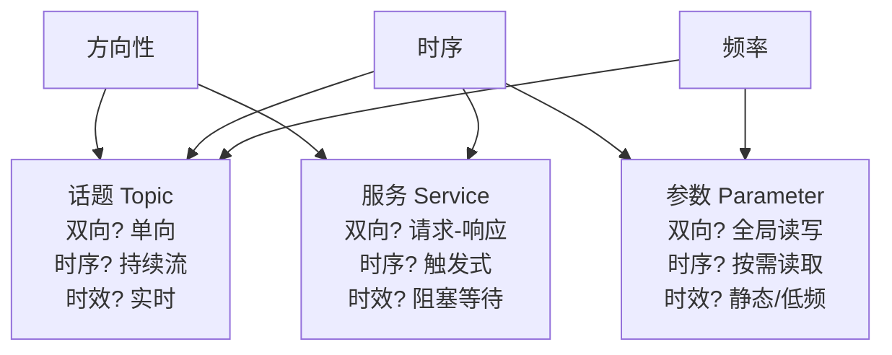
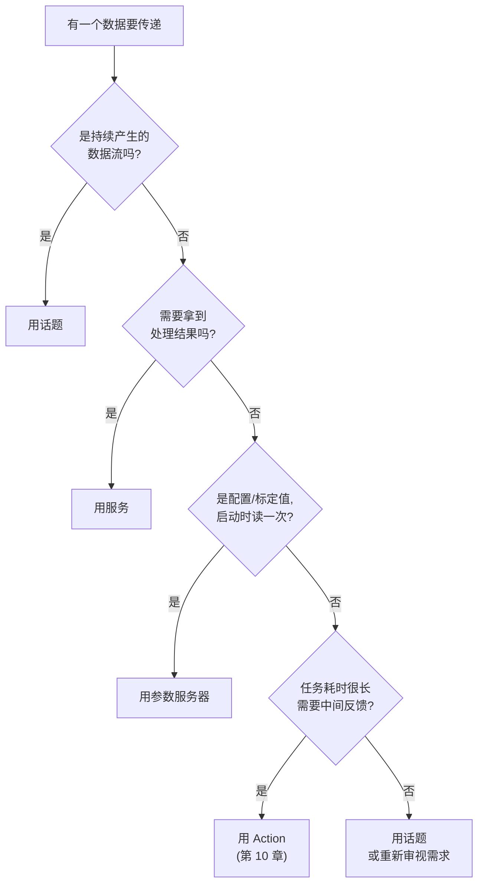
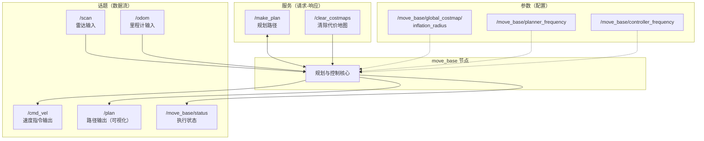

# 2.6 通信机制比较

> 本节学习目标：把话题、服务、参数三种机制放在同一张表上对比，掌握"面对一个需求该选哪种机制"的判断方法，并理解它们为什么不是互相替代的关系。

---

## 2.6.1 三种机制的本质差异

前三节我们分别实现了三种通信机制，2.5 节把它们放进同一个系统跑了起来。现在回答一个更实际的问题：**新写一个功能时，该用哪种？**

这个问题的答案取决于数据本身的三个属性，而不是个人偏好：

| 属性 | 问自己的问题 |
|------|-------------|
| **方向性** | 数据是单向流出，还是需要一问一答？ |
| **时序** | 是持续不断地来，还是触发一次、拿一次结果？ |
| **频率与时效** | 是运行时的高频数据，还是启动时的静态配置？ |

三种机制正是这三个维度上不同取值的组合结果：

一句话概括三者的分工：

- **话题**运送的是**流**。数据一旦产生就往外发，不关心有没有人收到，也不关心收到之后发生了什么。
- **服务**运送的是**一次请求的结果**。调用方用阻塞换取确定性：要么拿到响应，要么明确失败。
- **参数**存放的是**配置**。它在节点启动时被读取一次，用于改变节点行为，而不是用来传递业务数据。

理解了这三点，选型问题就变成了描述需求的问题。

---

## 2.6.2 完整对比表

| 对比维度 | 话题 (Topic) | 服务 (Service) | 参数 (Parameter) |
|---------|-------------|---------------|-----------------|
| **通信模型** | 发布 / 订阅 | 请求 / 响应 | 全局键值存储 |
| **数据流向** | 单向（发布者 → 订阅者） | 双向（客户端 ↔ 服务端） | 任意节点读写 |
| **同步性** | 异步，发完即返回 | 同步，阻塞直到响应 | 同步的 RPC 调用 |
| **通信双方** | 多对多 | 一对一（一个服务可被多客户端调用） | 无固定双方 |
| **是否阻塞调用方** | 否 | 是 | 否（单次读写很快，但仍是网络调用） |
| **底层协议** | TCPROS / UDPROS | TCPROS（ROS RPC） | XMLRPC |
| **触发方式** | 持续 / 周期性发布 | 客户端主动请求一次 | 按需读写 |
| **典型数据** | 传感器流、控制指令、状态 | 计算请求、模式切换、查询 | 阈值、PID 参数、路径、开关 |
| **典型频率** | 1 Hz ~ 1 kHz | 低频，随业务触发 | 启动时读，偶尔改 |
| **能否反馈进度** | 不适用（流本身就是反馈） | 否，只有最终结果 | 否 |
| **Master 参与程度** | 仅连接建立阶段 | 仅连接建立阶段，之后点对点 | Master 本身就是参数服务器 |
| **节点崩溃时的影响** | 发布者崩溃：订阅者静默失效 订阅者崩溃：发布者不受影响 | 服务端崩溃：客户端调用失败 客户端崩溃：服务端不受影响 | 参数仍在，读取正常 |
| **消息定义位置** | `.msg` | `.srv`（`---` 分隔请求与响应） | YAML，无需定义类型 |

表格里有两行值得单独展开，因为它们经常被误解。

**"Master 参与程度"**：三种机制的数据通路都不经过 Master，但参数服务器是唯一的例外。因为参数服务器**就是 Master 进程的一部分**，`rosparam set` 走的 XMLRPC 请求直接发给 Master。这也解释了为什么参数读写的速度远低于话题：它多了网络往返，而且是串行的。

**"节点崩溃时的影响"**：话题通信的失败是静默的。发布者进程死了，订阅者不会收到任何错误，它只是再也收不到消息，`rospy.spin()` 会一直安安静静地挂着。服务通信的失败是显式的，客户端会拿到 `ServiceException`。**这是话题通信最大的运维陷阱**：你需要自己加超时检测或者心跳机制，不能指望框架告诉你"对方没了"。

---

## 2.6.3 选型决策流程

把上面那张表压缩成一条可以照着走的判断路径：

这条流程的关键分叉点是第二个问题："**需要拿到处理结果吗？**"

需要结果，就必须用服务，因为话题根本没有返回通道。反过来，如果不需要结果却用了服务，代价是调用方会被阻塞，白白损失并发能力。这是新手最常见的误用：**用服务去发送本可以异步的指令**。

举个具体的例子。让机器人底盘"前进 1 米"：

- 如果把"开始移动"当作一条指令发给底盘，**用话题**。底盘自己控制轮子转多久，主控不需要等。
- 如果主控需要知道"到底移动成功了还是被障碍物挡住了"，**用服务**，让底盘处理完再返回结果。
- 如果这段移动可能需要 30 秒，中间还想显示进度条，**两者都不合适**，用 Action。

---

## 2.6.4 五个真实场景的选型分析

抽象规则不如具体案例。下面是五个机器人开发中的常见需求，以及对应的机制和理由。

### 场景一：激光雷达数据发布

**选择：话题**（`/scan`，`sensor_msgs/LaserScan`，约 10 Hz）

雷达驱动每 100ms 产生一帧数据，可能有零个、一个或多个节点在处理它（建图、避障、可视化），而且驱动不应该关心谁在用。这是话题的教科书场景：单向、持续、多订阅者。

如果这里用服务，驱动就得为每个消费者维护一个请求队列，而且没人请求时数据只能丢弃。**传感器数据永远是话题**。

### 场景二：查询机器人当前位姿

**选择：服务**（假设位姿不是持续发布的）

"把当前位置告诉我"是一次明确的查询，调用方需要立即得到坐标值才能继续。用话题硬凑也可以（让某个节点周期性发布位姿），但调用方要等到下一个周期才有数据，而且拿到的可能是几十毫秒前的旧值。

> 💡 但如果机器人本来就在高频发布里程计 `/odom`，**直接订阅那个话题更合理**。不要为了"用服务"而额外造一个服务，数据已经在流里了，就不要再去问一遍。

### 场景三：路径规划

**选择：服务**（`/make_plan`，传入起点终点，返回路径）

规划一次可能耗时几十到几百毫秒，调用方需要路径结果才能决定下一步。响应的数据量（一条路径）也不适合用参数或话题传。

这是 ROS 导航栈的实际做法：`move_base` 提供 `make_plan` 服务。但要注意导航栈同时也把规划结果**通过话题 `/plan` 发布出去**，供 Rviz 可视化。**同一个数据既用服务返回给请求方，又用话题广播给旁观者，这是完全正常的组合。**

### 场景四：保存当前地图

**选择：服务**（`/dynamic_map` 或自定义的 `/save_map`）

"把地图存到文件"是有明确成功或失败的操作，调用方需要知道结果。而且这是低频的、用户触发的动作，阻塞几百毫秒无所谓。

这类"命令 + 需要确认"的场景，服务是最自然的表达方式。地图服务器、`rosbag` 的录制控制、参数重载，都是这个模式。

### 场景五：机器人最大速度限制

**选择：参数**（`/max_vel_x`）

这是静态配置，与具体数据流无关，多个节点（速度解算、导航、安全监控）都要读它。启动时读一次，之后基本不变。

但这里有个**必须注意的时效问题**：如果你在节点运行期间把 `/max_vel_x` 从 1.0 改成 0.5，正在运行的节点**不会知道**。参数服务器没有变更通知机制，节点只在主动调用 `get_param` 的那一刻看到新值。

想让参数改动实时生效，只有两条路：

1. 节点自己在循环里周期性重新读取（简单，但有延迟和额外开销）
2. 使用第 10 章的**动态参数**（dynamic_reconfigure），它提供参数变更回调，还能自动生成 GUI 调参界面

2.5 节的实践练习让你亲手验证了这个现象：`rosparam set` 之后频率纹丝不动。

---

## 2.6.5 三种机制如何协同

选型问题容易给人一个错觉：每个需求只能选一种机制。实际项目里，**三种机制经常围绕同一个功能协同工作**。

以导航栈的 `move_base` 为例，它同时使用三种机制：

| 机制 | 在导航栈里承担的职责 |
|------|--------------------|
| **话题** | 传感器输入、速度输出、路径与状态的实时广播 |
| **服务** | 需要结果的离散操作：规划一条路径、清除代价地图 |
| **参数** | 代价地图膨胀半径、规划频率、容差阈值等配置 |

判断标准依然清晰：**输入输出是流就用话题，需要结果就用服务，影响行为方式的配置就用参数**。一个复杂节点三种都用，是正常的工程实践，不是混乱。

---

## 2.6.6 已知的局限与后续演进

三种机制各有覆盖不到的地方，这些空白正是后续章节的主题。

**服务无法报告进度。** 一个耗时 30 秒的任务，用服务的话调用方在这 30 秒里完全失去信息，一旦超时也无法知道服务端到底执行到哪一步了。**Action** 通信（第 10 章）就是为此设计的：它有目标（goal）、反馈（feedback）、结果（result）三段式结构，还支持取消。Action 本质上是在话题之上实现的一套约定，可以理解为"带进度反馈和取消能力的服务"。

**参数无法通知变更。** 如前面所说，参数改动不会推送给节点。**动态参数**（第 10 章）补上了这个能力：节点注册参数回调，客户端改参数时服务端立即响应，还能自动生成滑块界面。

**话题没有可靠投递保证。** 默认的 TCPROS 在连接期间是有序可靠的，但**连接建立之前发布的消息直接丢弃**，订阅者晚启动就会错过开头的数据。对必须收到的消息（比如任务指令），工程上的常见做法是加一层确认机制，或者改用服务。真正需要持久化和回放的场景，用 **rosbag** 录制后回放（第 5 章）。

**没有原生的请求-响应多播。** 服务是一对一的，话题是多对多的。想"向所有节点发起一个请求并收集每个节点的应答"，框架层面没有直接支持，需要自己用话题组合出发布-收集模式。

> ⚠️ **ROS 2 的变化**：ROS 2 里服务依然是请求-响应，但引入了 QoS 配置（可靠性、持久性、历史深度）让话题的投递语义可调，并且用 DDS 替代了自研的 TCPROS。参数在 ROS 2 中变成了每个节点自带的参数接口，变更可以注册回调。这些改动的方向，正是为了解决上面列的几个局限。本教程基于 ROS 1 Noetic，ROS 2 的对应机制不在范围内。

---

## 本节小结

| 判断条件 | 选择 |
|---------|------|
| 持续产生的数据流、单向、多个消费者 | **话题** |
| 需要处理结果、低频、可接受阻塞 | **服务** |
| 静态配置、启动时读取、多节点共享 | **参数** |
| 耗时任务 + 进度反馈 + 可取消 | **Action**（第 10 章） |
| 配置需要运行时生效 | **动态参数**（第 10 章） |

三条最容易记错的原则：

1. **话题的失败是静默的**。发布者挂掉不会有任何通知，需要自己加超时检测。
2. **参数不会通知变更**。改了参数，运行中的节点不会自动知道。
3. **同一个功能可以同时用多种机制**。返回结果用服务，对外广播用话题，这很常见。

选型时不要问"哪个更高级"，要问"这个数据的方向、时序和频率是什么"。答案自然就出来了。

---

## 第 2 章回顾

第 2 章完整覆盖了 ROS 1 的三种基础通信机制：

| 小节 | 内容 | 核心产出 |
|------|------|---------|
| [2.1 话题通信](06-topic.md) | 发布/订阅模型、C++ 与 Python 实现、自定义 msg | 会写发布者和订阅者 |
| [2.2 服务通信](07-service.md) | 请求/响应模型、自定义 srv、服务端与客户端 | 会写服务接口并调用 |
| [2.3 参数服务器](08-parameter.md) | 全局键值存储、C++ 与 Python 读写、launch 配置 | 会用参数做配置管理 |
| [2.4 常用命令](09-commands.md) | rosnode / rostopic / rosmsg / rosservice / rossrv / rosparam | 会用命令行检查系统状态 |
| [2.5 通信机制实操](10-communication-practice.md) | 三机制并存的完整系统 | 能独立实现并验证 |
| 2.6 通信机制比较 | 对比、选型、协同、局限 | 能为需求选对机制 |

📖 **深入阅读**：

- [ROS 架构详解](../../arch.md) — 节点、Master、计算图的底层设计
- [ROS 1 通信机制详解](../../comm.md) — TCPROS / XMLRPC 协议栈细节
- [ROS 常用命令速查手册](../../ros_cmd.md) — 命令参数完整参考

**章节导航**：

- ⬅️ **上一节**：[2.5 通信机制实操](10-communication-practice.md)
- ➡️ **下一章**：[第 3 章 ROS 通信机制进阶](../index.md) — 初始化、对象模型、回调、时间与模块组织
